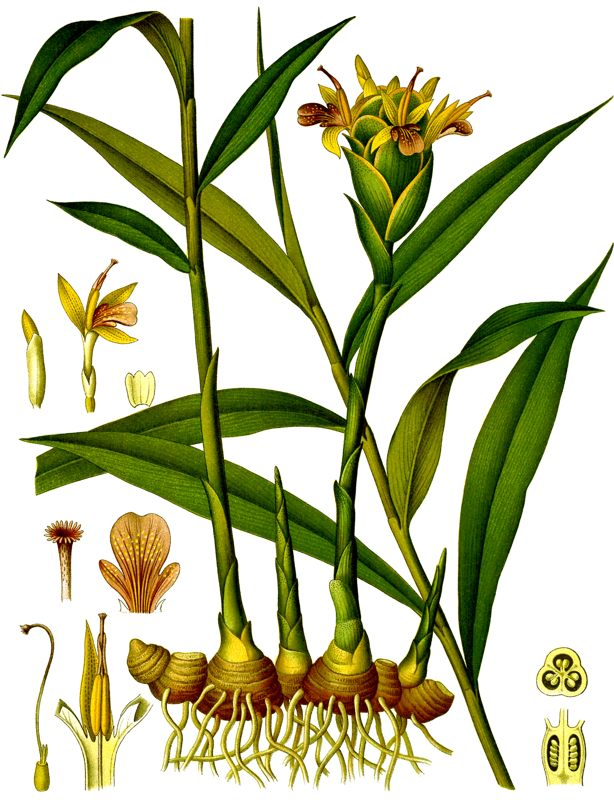
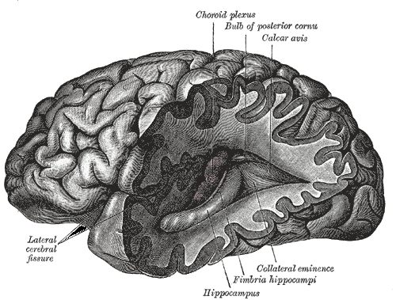

# Vor dem ersten Bild

Ein botanischer Zeichner kann an einem einzigen Zweig mehr zeigen, als ein Foto in einem Augenblick festhalten könnte. Neben der Pflanze stehen Vergrößerungen und Schnitte. Eine anatomische Zeichnung folgt einem ähnlichen Prinzip: Gewebe wird so dargestellt, dass eine räumliche Beziehung sichtbar wird. Beide Bildformen sagen zunächst etwas über **Gestalt und Lage**. Die Funktion müssen wir aus anderen Quellen erschließen.

Dieser kleine Bildatlas gibt den Abbildungen bewusst das erste Wort. Betrachte jede Tafel, bevor du den Text darunter liest. Suche jeweils eine Beobachtung, auf die du mit dem Finger zeigen könntest. Suche danach eine Aussage, für die du eine Studie brauchst. Zwischen diesen beiden Schritten liegt ein großer Teil wissenschaftlicher Wissensvermittlung.

# Tafel I · Wo wächst ein Pfefferkorn?

**Blick auf die Tafel.** In der Küche begegnet uns schwarzer Pfeffer meist als einzelnes Korn. Hier hängt die Frucht am Zweig. Die Zeichnung stellt Blätter und langgestreckte Fruchtstände nebeneinander und löst kleine Teile zur Betrachtung aus ihrem Zusammenhang. Folge mit dem Blick dem Stiel eines Blattes. Suche anschließend einen Fruchtstand. Die Tafel hilft dabei, beides räumlich zu unterscheiden.

**Blick in den Foodatlas.** Eine Molekülbezeichnung ist auf dem Zweig unsichtbar. Der Atlas führt bei schwarzem Pfeffer unter anderem β-Caryophyllen auf und verknüpft es mit Untersuchungen zum CB2-Rezeptor. Gertsch und Kollegen beschrieben eine Rezeptorwirkung des Einzelstoffs und einen CB2-abhängigen Befund bei Mäusen. Andere funktionelle Tests fanden wenig Unterstützung für eine direkte Wirkung unter ihren jeweiligen Bedingungen. Die Abbildung ist der Einstieg in diese Frage, kein Beleg dafür, dass eine Mahlzeit den gleichen Effekt auslöst. [Gertsch et al.](https://pubmed.ncbi.nlm.nih.gov/18574142/) · [Finlay et al.](https://pubmed.ncbi.nlm.nih.gov/32269529/)

**Bildaufgabe.** Gib der Tafel zwei Bildunterschriften. Die erste beginnt mit „Zu sehen ist …“. Die zweite beginnt mit „Untersucht wurde …“. Gehört „CB2“ in die erste oder in die zweite? Die Zuordnung trennt die Herkunft des Forschungsgegenstands von der Methode, mit der über ihn etwas herausgefunden wurde.

# Tafel II · Ingwer hat mehr als eine Ansicht

**Blick auf die Tafel.** Wer frischen Ingwer schneidet, hält einen Teil der Pflanze in der Hand. Die historische Tafel bringt ihn mit oberirdischen Teilen in Verbindung. Das verdickte Rhizom ist ein Sprossorgan. Die bildliche Nachbarschaft von Blättern, Rhizom und Blüte erspart eine häufige Verwechslung: Die Küchenbezeichnung „Wurzel“ und die botanische Einordnung beantworten unterschiedliche Fragen.

**Blick in die Studie.** Eine Arbeit zum Ingwerinhaltsstoff [6]-Gingerol untersuchte menschliche neutrophile Granulozyten. Der Unterschied zwischen „menschliche Zellen“ und „eine Person isst eine Portion Ingwer“ ist hier entscheidend. Das Zellmodell kann Hinweise auf einen Mechanismus liefern. Für eine Aussage über den Verzehr müssten unter anderem die Zubereitung, die erreichte Konzentration und ein Endpunkt beim Menschen bestimmt werden. [Andersen et al.](https://pubmed.ncbi.nlm.nih.gov/36564924/)

**Bildaufgabe.** Stell dir drei Aufnahmen vor: eine Pflanzentafel, ein Mikroskopbild menschlicher Zellen und ein Diagramm mit einem Messwert vor und nach dem Verzehr. Welche Aufnahme hilft bei der Bestimmung der Pflanzenart? Welche könnte die Herkunft des biologischen Materials erläutern? Für das dritte Bild bräuchtest du zusätzlich die Beschreibung des Versuchs. Kein einzelnes dieser Bilder kann die beiden anderen ersetzen.

# Tafel III · Orientierung im Gehirn

**Blick auf die Tafel.** Die Zeichnung von Henry Vandyke Carter zeigt Anteile des linken Seitenventrikels von der Seite. Die Beschriftungen erschließen Nachbarschaften in der Tiefe des Gehirns. Der Hippocampus liegt am unteren Horn des Seitenventrikels. Suche die Begrenzungen des freigelegten Raums, bevor du einzelne Namen liest. So wird aus einer Gruppe von Begriffen ein räumliches Bild.

**Blick in den Hypothesenatlas.** Der Gyrus dentatus gehört zur Hippocampusformation. Chávez und Kollegen untersuchten dort an Gewebepräparaten einen Vorgang, an dem Anandamid und der Ionenkanal TRPV1 beteiligt waren. Gemessen wurde eine anhaltende Abschwächung bestimmter synaptischer Antworten. Auf einer anatomischen Tafel lässt sich der Ort grob einordnen. Für den zeitlichen Verlauf der Antwort sind elektrische Messungen erforderlich. Die menschliche Anatomietafel und das experimentelle Gewebe stammen aus verschiedenen Quellen und haben unterschiedliche Aufgaben. [Chávez et al.](https://pubmed.ncbi.nlm.nih.gov/21076423/)

**Bildaufgabe.** Zeichne ein Koordinatensystem. Beschrifte die waagerechte Achse mit „Zeit“ und die senkrechte mit „synaptische Antwort“. Versuche, aus der historischen Tafel eine Kurve einzuzeichnen. Dass dafür Angaben fehlen, ist das Ergebnis der Übung: Eine Karte kann zeigen, wo man suchen könnte. Sie enthält keine Zeitreihe.

# Drei Bilder, drei Arten von Belegen

Eine Illustration beantwortet eine anschauliche Frage. Eine chemische Analyse kann einen Stoff in einer Probe nachweisen. Eine funktionelle Messung untersucht, ob eine Zielstruktur unter bestimmten Bedingungen reagiert. In guten Projekteinträgen lassen sich diese Aussagen einzeln wiederfinden. In einer vorschnellen Erzählung verschmelzen sie zu einem großen Wirkversprechen.

Öffne im [Foodatlas](https://marcelmolitor.github.io/ecs-food-atlas/) ein Pflanzenprofil und notiere, welche dieser drei Arten von Belegen dort verlinkt sind. Wechsle anschließend in den [Hypothesenatlas](https://marcelmolitor.github.io/ecs-hypothesen/). Formuliere zu einem Befund die kleinste offene Frage, die dich interessiert. Vielleicht geht es um einen Ort, einen Zeitpunkt oder eine Vergleichsgruppe. Die Frage darf klein bleiben. Kleine Fragen machen sichtbar, welche neue Abbildung oder Messung tatsächlich etwas hinzufügen würde.

## Bildnachweise und Ausgabe

1. Schwarzer Pfeffer, *Köhler’s Medizinal-Pflanzen*, historische Tafel 107. [Dateiseite und Gemeinfreiheitsvermerk](https://commons.wikimedia.org/wiki/File:Piper_nigrum_-_K%C3%B6hler%E2%80%93s_Medizinal-Pflanzen-107.jpg).
2. Echter Ingwer, *Köhler’s Medizinal-Pflanzen*, Tafel 146, Fassung ohne Beschriftung. [Dateiseite und Gemeinfreiheitsvermerk](https://commons.wikimedia.org/wiki/File:Koeh-146-no_text.jpg).
3. Henry Vandyke Carter, Abbildung 739 aus *Gray’s Anatomy*, Ausgabe 1918. [Dateiseite und Gemeinfreiheitsvermerk](https://commons.wikimedia.org/wiki/File:Gray739.png).

Die Abbildungen wurden über Wikimedia Commons bezogen und für die EPUB-Ausgabe verkleinert bzw. als JPEG gespeichert. Alle drei liegen im Buch selbst, sodass sie auch offline lesbar sind. Redaktion mit KI-Unterstützung. Erste Ausgabe, 26. November 2026.

**Unterstützen:** Die Bücher und der Zugang zu den Fachquellen bleiben frei. Wer die Pflege der Atlanten und weitere Bildausgaben mittragen möchte, findet hier die [freiwillige PayPal-Unterstützung](https://www.paypal.biz/molitormarcel93).
